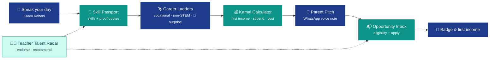
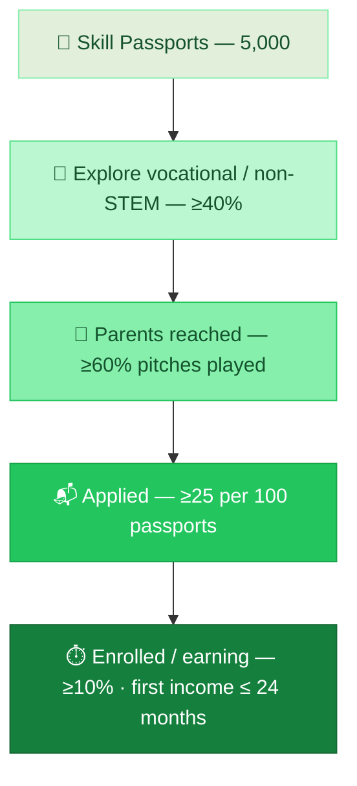
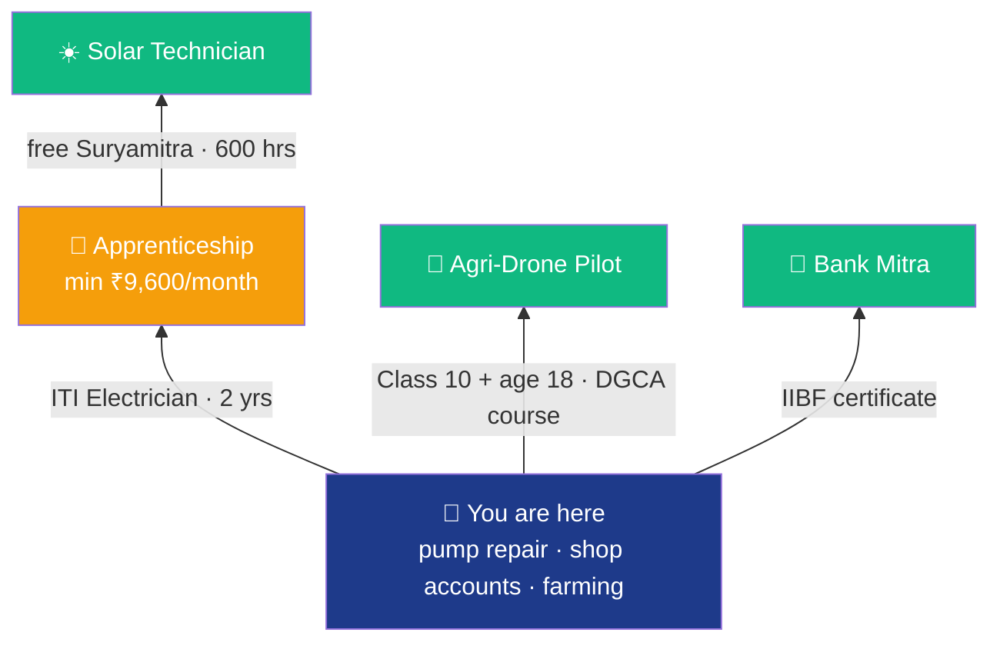
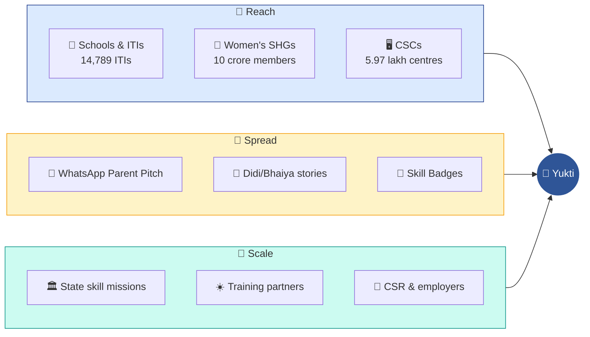
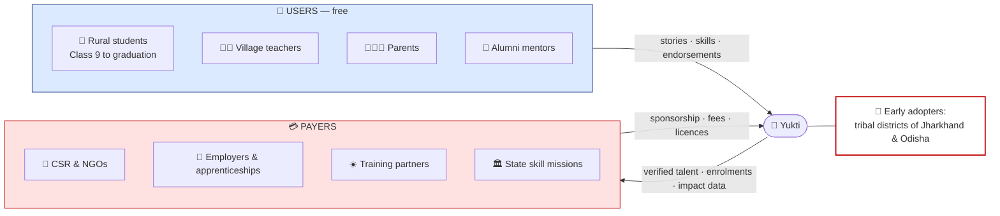

# Yukti — Lean Canvas Pitch Deck (Slide-by-Slide Content)

> **Citi India Hackathon — "Reimagining Education & Economic Empowerment for Rural India"**
> This deck follows the hackathon Lean Canvas legend **exactly**: 9 slides, in the same order, with the same block names and the same colour coding.
> Each slide gives: the template question, the headline, the exact on-slide text, the layout, any diagram (with a detailed generation prompt plus a Mermaid backup), and speaker notes.
> **Every number is researched and labelled** (see the legend below). Full sources are in [Section 11](#11-fact-bank--sources).

---

## Data Labels Used in This Deck

| Label | Meaning | How to show it on the slide |
| :--: | :--- | :--- |
| ✅ | **Verified from the primary source** (official report or peer-reviewed paper, read directly) | Normal source line |
| 🟡 | **Reported**: official figure, but read through press or summary coverage, not the original document | Source line; say "reported" if asked |
| 🧮 | **Our calculation** from cited inputs (the assumptions are shown) | Label "Illustrative calculation" on the slide |
| 🎯 | **Our target** for a pilot (a goal, not data) | Label "Pilot target" on the slide |

### Corrections made after research

| Earlier claim | Status now |
| :--- | :--- |
| "93% of schools have no counsellor" | Downgraded to 🟡 advocacy estimate (~90%+); only in speaker notes, replaced on the slide by ✅ ASER data |
| "5.6% of rural youth take vocational training" | ✅ Verified in ASER 2023 main findings |
| "Solar technician: free, income in ~4 months" for a Class 10 student | **Wrong.** Suryamitra needs Class 10 **+ ITI** (or a diploma) and age 18+. Corrected path: ITI → apprenticeship stipend → free Suryamitra |
| "₹8.2 lakh vs ₹1.44 lakh in 5 years" | Removed (it came from our own model). Replaced by a 🧮 calculation using official stipend and PLFS wage figures |
| "Regular degree: first income after 42 months" | Replaced: from Class 10, the degree path takes **60 months** (2 years Class 11–12 + 3-year degree) |
| "< ₹1 AI cost per session" | Recalculated with published API prices: **≈ ₹0.13 per session** 🧮 |
| Pilot targets | Kept, clearly labelled 🎯, with real baselines next to them |

> **Note for later (project code, not touched now):** `data/careers.json` still has the old solar-technician timeline (first income in 4 months), the 42-month degree baseline and the pre-2025 stipend values. Update them to match this deck when you work on the project.

---

## 0. How to Use This File

| Item | Rule |
| :--- | :--- |
| **Slide order** | Problem → Existing Alternatives → Solution → Key Metrics → Unique Value Proposition → High Level Concept → Unfair Advantage → Channels → Customer Segments |
| **Slide title** | Use the legend block name **word for word** |
| **Template question** | Show it as a small grey line under the title |
| **Colour strip** | A vertical colour bar on the left in that block's legend colour |
| **Text** | Only the "On-slide content" text goes on the slide; the rest goes in speaker notes |
| **Source line** | Every slide with numbers carries a 9 pt source line at the bottom |
| **Diagrams** | AI image tools often misspell text. Generate the visual only and type labels in PowerPoint, **or** paste the Mermaid code into [mermaid.live](https://mermaid.live) and export SVG/PNG |
| **Timing** | About 25 seconds per slide, so 9 slides fit in about 4 minutes |

### Legend colour code (from the template)

| # | Block | Strip / accent colour | Text on strip |
| :--: | :--- | :--- | :--- |
| 1 | Problem | Light blue `#DDEBF7` | Dark `#1F2937` |
| 2 | Existing Alternatives | Peach `#FCE4D6` | Dark |
| 3 | Solution | Cream yellow `#FFF2CC` | Dark |
| 4 | Key Metrics | Light green `#E2EFDA` | Dark |
| 5 | Unique Value Proposition | Bright yellow `#FFFF00` | Dark |
| 6 | High Level Concept | Green `#92D050` | Dark |
| 7 | Unfair Advantage | Orange `#ED7D31` | White |
| 8 | Channels | Blue `#2F5597` | White |
| 9 | Customer Segments | Red `#C00000` | White |

### Global design system

| Element | Spec |
| :--- | :--- |
| Aspect ratio | 16:9 |
| Background | White `#FFFFFF`; cards `#F8FAFC` with a `#E2E8F0` border |
| Brand colours | Indigo `#1E3A8A`, teal `#0D9488`, amber `#F59E0B`, green `#10B981` |
| Fonts | **Inter** (English), **Noto Sans Devanagari** (Hindi) |
| Sizes | Title 32–36 pt bold · template question 12 pt grey `#64748B` · body 16–18 pt · big numbers 40–54 pt bold · source line 9 pt |
| Footer | Left: "Yukti · Learning to Livelihood" · Right: team name + slide number |
| Logo | Top right: "ES" indigo square + "Yukti" |
| Icons | One flat line-icon set throughout (Phosphor / Lucide), in indigo |

### Standard slide skeleton

```
┌─────────────────────────────────────────────────────────────────────────┐
│▌ [BLOCK NAME]  (32pt bold)                                   [ES logo] │
│▌ Template question (12pt grey)                                          │
│▌ ─────────────────────────────────────────────────────────────────────  │
│▌ Headline / key message (20pt, indigo)                                  │
│▌            [ MAIN CONTENT AREA: cards / table / diagram ]              │
│▌ Source line (9pt grey)                                                 │
│▌ Yukti · Learning to Livelihood                  Team · slide n/9  │
└─────────────────────────────────────────────────────────────────────────┘
 ▌ = vertical strip in the block's legend colour
```

> **Optional cover slide:** only if the template allows. Text: "Yukti (एडू-सारथी) — From learning to livelihood, in your own language and voice", plus team name and college.

---

## 1. Slide 1 — Problem

**Legend colour:** Light blue `#DDEBF7`
**Template question:** *List of the top 1 to 3 problems your target customers face. How prevalent are the problems?*

### Headline
**Rural teenagers already work, but no one counts it as a skill. Degrees don't guarantee jobs, and the doors that do exist stay half-empty.**

### On-slide content (3 problem cards)

| Card | Problem | How prevalent (data) |
| :--: | :--- | :--- |
| **1 · 🔍 Real skills, never counted** | Teenagers work on family farms, shops and repairs, but nobody turns that into a recognised skill or path. | **40%** of rural boys and **28%** of girls aged 14–18 already do work beyond housework, mostly on family farms ✅ · yet only **5.6%** take any vocational training ✅ |
| **2 · 🎓 Degree ≠ job, and families decide blind** | Most students drift into general degrees; parents choose without knowing time-to-income or costs. | **29.1%** of graduates are unemployed 🟡 · **55.7%** of rural Class 11+ students are in Arts/Humanities ✅ |
| **3 · 🚪 Doors exist but stay half-empty** | Skill seats, apprenticeships and schemes exist, but students don't find, trust or reach them. | Only **48%** of 25.4 lakh ITI seats are filled 🟡 · only **~1 in 4** rural youth has used a phone for an online service like filling a form ✅ |

**Bottom strip: "Why it must be voice-first"**
> **~1 in 4** rural 14–18-year-olds can't fluently read a Class 2 text in their own language ✅ · yet **~90%** have a smartphone at home ✅

**Source line:** *ASER 2023 "Beyond Basics" (34,745 rural youth, 28 districts); India Employment Report 2024 (ILO & IHD); NITI Aayog, Transforming ITIs (2023).*

### Layout
- Three equal cards. Each has a large icon, the problem title in bold, a one-line description, and the **big number** (44 pt, indigo) with its label.
- A full-width indigo strip at the bottom for the voice-first fact.

### Speaker notes (≈25 s)
> "In ASER's 2023 survey of nearly 35,000 rural teenagers, 40% of boys and 28% of girls were already working, mostly on family farms, yet only 5.6% were in any vocational training. Meanwhile 29% of graduates are unemployed, and more than half of ITI seats lie empty. And one in four of these teenagers can't fluently read a Class 2 text, but nine in ten have a smartphone at home. That's why we built for voice."
>
> *(If asked about counselling: advocacy estimates suggest 90%+ of Indian schools have no professional counsellor. That's not an official statistic, so it isn't on the slide.)*

---

## 2. Slide 2 — Existing Alternatives

**Legend colour:** Peach `#FCE4D6`
**Template question:** *What are the existing alternatives to the problems outlined?*

### Headline
**Today's options either guess, test in English, or list schemes on portals, and none of them listens, shows the money, or reaches the family.**

### On-slide content (comparison table)

| Existing alternative | What it does | Gap (with data) |
| :--- | :--- | :--- |
| 👪 Relatives & neighbours | Advice from experience | Limited to familiar jobs; no earnings data |
| 🧑‍🏫 School teachers / ITI instructors | Informal guidance | Overstretched: only **36%** of sanctioned ITI instructor posts are filled 🟡 |
| 📝 Aptitude / psychometric test apps | Quiz → career list | English-first, but only **57%** of rural youth can read English sentences ✅; misses real practical skills |
| 🏛️ Govt portals (NSP, Skill India Digital, NAPS, DIKSHA, SWAYAM) | Schemes, courses, apprenticeships | Separate, form-heavy; only **~1 in 4** rural youth has used a phone for an online service ✅ |
| ☀️ Free government courses (e.g. Suryamitra solar) | Free residential training + placement help | Small reach: **60,685** trained to date 🟡; strict entry (ITI/diploma, 18+); low awareness |
| 🤖 Generic AI chatbots | Answer questions | Not grounded; can invent schemes, salaries and eligibility |

**Capability check (✓ / ✗ grid):**

| Capability | Relatives | Test apps | Govt portals | Generic AI | **Yukti** |
| :--- | :--: | :--: | :--: | :--: | :--: |
| Voice, in local language | ✓ | ✗ | ✗ | ~ | **✓** |
| Finds hidden practical skills | ✗ | ✗ | ✗ | ✗ | **✓** |
| Shows months to first income & cost | ✗ | ✗ | ✗ | ✗ | **✓** |
| Talks to parents | ✓ | ✗ | ✗ | ✗ | **✓** |
| Eligibility check with reasons | ✗ | ✗ | ~ | ✗ | **✓** |
| Teacher / facilitator mode | ✗ | ✗ | ✗ | ✗ | **✓** |

**Source line:** *ASER 2023; NITI Aayog, Transforming ITIs (2023), via Careers360; NISE Suryamitra programme data.*

### Layout
- Top half: the 6-row table with icons.
- Bottom half: the ✓/✗ grid with the **Yukti column highlighted** `#DBEAFE`. Green ✓, red ✗, grey ~ (partial).

### Speaker notes (≈25 s)
> "Students rely on relatives, overstretched teachers (only 36% of ITI instructor posts are filled), English test apps when only 57% can read English sentences, and portals that only one in four rural teens has ever used for an online service. Even great free programmes like Suryamitra have trained about 60,000 people in total. Each solves a piece; none listens, shows the money, or brings the parents along."

---

## 3. Slide 3 — Solution

**Legend colour:** Cream yellow `#FFF2CC`
**Template question:** *Outline the top features or minimum viable product (MVP) concept for each problem.*

### Headline
**Yukti: speak your day → see your skills, your path and your first income → bring your family along → apply.**

### On-slide content

**Top: problem → MVP feature mapping (same numbering as Slide 1)**

| Problem | MVP features |
| :--- | :--- |
| **1 · Real skills, never counted** | 🎤 **Kaam Kahani**: speak your day in your language, and AI finds the skills you already have · 🪪 **Skill Passport**: each skill backed by your own words · 🪜 **Career Ladders**: paths from your skills, always including a vocational, a non-STEM and a 🎲 **surprise** career |
| **2 · Degree ≠ job, families decide blind** | 💰 **Kamai Calculator**: months to first income, stipend, cost vs a regular degree, using official rates · 📣 **Parent Pitch**: a voice message to parents in their language, on WhatsApp |
| **3 · Doors half-empty** | 📬 **Opportunity Inbox**: ITI seats, apprenticeships, schemes and scholarships with a rule-based eligibility check · 🧑‍🏫 **Teacher Talent Radar**: one phone, many students; spot and recommend talent · 🏅 **Skill Badges**: verified proof of skill |

**Middle: MVP user flow** (diagram below)

**Bottom: "Why these levers work" evidence box (3 lines, small)**

| Lever | Evidence |
| :--- | :--- |
| Showing real earnings changes choices | Dominican Republic RCT: students told the real returns to schooling stayed **0.20–0.35 years longer** in school (Jensen, *QJE* 2010) ✅ |
| Information + placement help opens jobs | India RCT in **80 villages**: recruiting help made young women **4.6 pp** more likely to hold BPO jobs and **~5 pp** more likely to be in school (Jensen, *QJE* 2012) 🟡 |
| Parents must be convinced | Bhutan RCTs: mentoring raised interest in vocational paths, but **parental scepticism and stigma** limited enrolment (Hayashi et al., *JPAM* 2025) ✅ |

**Footer:** *Low-end Android · 9 Indian languages · voice in and out · Low-Data Mode · open source (MIT)*

### Layout
- Top 45%: three columns linked to Slide 1's cards (same icons).
- Middle 35%: the horizontal flow diagram.
- Bottom 20%: the evidence box in small text, with citations.

### Diagram — MVP User Flow

**Detailed image-generation prompt:**

```
Create a clean, flat, horizontal process flowchart for a presentation slide, 16:9, white background,
modern minimal infographic style, no 3D, no gradients, no photo-realism.

Show 7 rounded-rectangle steps connected left-to-right by thick arrows, in one row:
1. Microphone icon - label "Speak your day" - small subtext "Kaam Kahani, any Indian language"
2. ID-card icon - label "Skill Passport" - subtext "Skills + your own words as proof"
3. Ladder icon - label "Career Ladders" - subtext "Vocational, non-STEM + surprise"
4. Rupee coin icon - label "Kamai Calculator" - subtext "First income, stipend, cost"
5. Family icon (parents + child) - label "Parent Pitch" - subtext "Voice note on WhatsApp"
6. Inbox/envelope icon - label "Opportunity Inbox" - subtext "Eligibility check + apply"
7. Medal icon - label "Badge & first income" - subtext "Verified skill"

Below steps 2 to 6, draw one wide light-teal rounded band labelled "Teacher Talent Radar: endorse & recommend",
with thin dotted arrows from the band up to steps 2 and 6.

Colours: step boxes alternate deep indigo #1E3A8A and teal #0D9488 with white text; arrows amber #F59E0B;
the band light teal #CCFBF1 with dark text. Simple white line icons inside each box.
Font: Inter, bold labels, regular subtext. Generous spacing, high contrast. Spell every label exactly as written.
```

**Mermaid backup:**



### Speaker notes (≈30 s)
> "Rahul speaks his day in Hindi; the AI finds his skills and quotes his words as proof. Our engine builds ladders from official data, always with a vocational, a non-STEM and a surprise option. The Kamai Calculator uses official rates: after a two-year ITI, an apprentice earns at least ₹9,600 a month, and then the free Suryamitra solar course opens up. One tap sends a voice note to his father, because research from Bhutan shows parents' doubts are what block vocational paths. And randomised trials in the Dominican Republic and in Indian villages show that real earnings information and placement help change what young people do."

---

## 4. Slide 4 — Key Metrics

**Legend colour:** Light green `#E2EFDA`
**Template question:** *Choose 3 to 5 numbers or indicators that track key user actions and business growth. How will you define success for your company? What are the KPIs you want to aim for?*

### Headline
**Success = more rural students reaching a first income sooner, on a path they and their family chose.**

### On-slide content

**North-star metric (top banner):**
> ⭐ **Students who enrol in a skill path or start earning within 24 months of creating their Skill Passport**

**5 KPIs: target 🎯 vs today's baseline (data)**

| # | KPI | 6-month pilot target 🎯 | Today's baseline (data) |
| :--: | :--- | :--- | :--- |
| 1 | 🪪 **Skill Passports completed** | **5,000** (50 schools/ITIs × ~100 students), **≥ 4** evidence-backed skills each | No record of informal skills exists today |
| 2 | 🌿 **Options widened**: % who explore a vocational / non-STEM path | **≥ 40%** | Only **5.6%** of rural 14–18s take any vocational training ✅ |
| 3 | 📣 **Family reached**: % of Parent Pitches played | **≥ 60%** | **90.5%** of rural youth used social media in the past week, so WhatsApp reach is realistic ✅ |
| 4 | 📬 **Applications → enrolments** per 100 passports | **≥ 25** applications; **≥ 10%** enrolled or placed | ITI seats only **48%** filled 🟡; Suryamitra places **~50%** of its trainees 🟡 |
| 5 | ⏱️ **Months to first income** (from Class 10) | **≤ 24 months** median for vocational choosers | Degree path: **60 months** of study before graduating 🧮, then **29.1%** graduate unemployment 🟡 |

**Business health strip (small text):**
> Active facilitators · students per facilitator (target 30+) · modules published · sponsorship revenue · **AI cost per student session ≈ ₹0.13** 🧮

*🎯 = pilot goals, not results. Pilot: 2 tribal districts, ~50 schools/ITIs, via an NGO partner.*

### Layout
- Top: a green banner with the north star.
- Middle: 5 tiles showing the **target** big (44 pt) and the **baseline** small underneath ("today: 5.6%").
- Bottom: the business strip and the 🎯 footnote.

### AI cost calculation 🧮 (for speaker notes / Q&A)

| Input | Value |
| :--- | :--- |
| Model | OpenAI `gpt-4o-mini`: **$0.15 per 1M input tokens, $0.60 per 1M output tokens** (published pricing, via price trackers 🟡) |
| Tokens per full session | ~3,500 input + ~1,500 output (skill extraction + 4 explanations + 1 parent message) |
| Cost | 3,500 × $0.15/1M + 1,500 × $0.60/1M = **$0.0014 ≈ ₹0.13** (at ~₹88/$) |
| Safety margin | Even at 3× tokens for Indian scripts, **< ₹0.50** per student |

### Diagram — KPI funnel (optional)

**Detailed image-generation prompt:**

```
Flat vertical funnel infographic for a pitch slide, white background, minimal modern style, no 3D.
5 stacked funnel layers from widest (top) to narrowest (bottom), shades of green from light #E2EFDA to dark #15803D:
1. "Skill Passports - 5,000"
2. "Explore vocational / non-STEM - 40%"
3. "Parents reached - 60% of pitches played"
4. "Applied - 25 per 100 passports"
5. "Enrolled / earning - 10%+"
Right of the funnel, a gold star with the text "North star: first income within 24 months".
Small grey caption at the bottom: "Pilot targets". Inter font, bold numbers, exact spelling.
```

**Mermaid backup:**



### Speaker notes (≈25 s)
> "Our north star is students who enrol in a skill path or start earning within two years. Every target sits next to today's reality: only 5.6% take vocational training today, and we aim for 40% to explore it. A degree means five years of study after Class 10, then a 29% chance of unemployment; we target a first income within 24 months. And it's affordable: about 13 paise of AI cost per student session."

---

## 5. Slide 5 — Unique Value Proposition

**Legend colour:** Bright yellow `#FFFF00`
**Template question:** *Write a clear, compelling message stating why your product is different and worth paying attention to.*

### Headline (the UVP, large, centred)
# "Speak your day. See your skills, your path and your first income — and bring your family along."

**Hindi line (Noto Sans Devanagari):**
> **"अपना दिन बोलो — अपना हुनर, अपना रास्ता और अपनी पहली कमाई देखो।"**

### On-slide content (3 proof points)

| Proof point | One line (with the fact behind it) |
| :--- | :--- |
| 🎤 **Listens, doesn't test** | Voice-first in 9 Indian languages, because 1 in 4 rural teens can't fluently read a Class 2 text, while ~90% have a smartphone at home ✅ |
| 🧭 **Widens and grounds** | Always shows vocational, non-STEM and surprise careers; every number comes from official sources (ITI, NAPS, PLFS), so the AI can't invent jobs or salaries |
| 👨‍👩‍👧 **Moves the real decision-maker** | Speaks to parents on WhatsApp, the barrier randomised trials identify behind low vocational enrolment ✅ |

**Tagline (small, indigo):** *"AI understands and explains. Data and code decide."*

### Layout
- A bright yellow band across the middle third with the UVP in 34–40 pt bold black, centred, and the Hindi line under it in 22 pt.
- Three proof-point cards below. Keep it very clean: this is the "remember us" slide.

### Speaker notes (≈20 s)
> "Speak your day, and see your skills, your path and your first income, and bring your family along. We listen instead of testing, because one in four of these students struggles to read. We widen options with official data instead of guesses. And we talk to the parents who actually decide."

---

## 6. Slide 6 — High Level Concept

**Legend colour:** Green `#92D050`
**Template question:** *List your X for Y analogy e.g., YouTube = Flickr for videos or GitHub = Facebook for software developers or Airbnb = eBay for spare bedrooms*

### Headline (the analogy, large)
# Yukti = **Google Maps for rural careers**

**Sub-line:**
> *Starts from where you are (your skills) · shows every route (career ladders) · tells you the travel time (months to first income) and the toll (cost and stipend) · finds the stops on the way (opportunities).*

### On-slide content (analogy mapping)

| Google Maps | Yukti |
| :--- | :--- |
| 📍 Your current location | 🪪 **Skill Passport**: the skills you already have |
| 🛣️ Alternative routes | 🪜 **Career Ladders**: vocational, non-STEM, 🎲 surprise |
| ⏱️ Travel time | ⏱️ **Months to first income** |
| 💵 Toll / fare | 💰 **Cost & stipend** (e.g. apprentice minimum ₹9,600/month) |
| 🗣️ Voice navigation | 🎤 **Voice in 9 Indian languages** |
| 📌 Places along the way | 📬 **ITI seats, apprenticeships, schemes, mentors** |

**Secondary analogies (small, bottom):**
> *"LinkedIn + a career counsellor for village students — by voice"* · *"Duolingo-simple, Naukri-useful, in your mother tongue"*

### Layout
- Left 45%: the illustration.
- Right 55%: the analogy headline and the mapping table.

### Diagram / illustration — Career map

**Detailed image-generation prompt:**

```
Flat vector illustration for a pitch slide, left-half composition, white background, friendly Indian rural theme,
minimal style, no text except the short labels listed.
A stylised map from above: bottom-left, a small Indian village (huts, a borewell pump, a paddy field, a small shop)
with a big map pin labelled "You are here".
From the pin, three winding roads lead up to three destinations:
- green road to a building with solar panels (label "Solar Technician"), with two signposts on it: "ITI" and "Apprenticeship"
- amber road to a farmer group office with a drone above it (label "Agri-Drone Pilot")
- teal road to a small bank kiosk (label "Bank Mitra")
Tiny rupee coin icons along the roads. A smartphone in the bottom-right shows a microphone and sound waves (voice navigation).
Colours: indigo #1E3A8A, teal #0D9488, amber #F59E0B, green #10B981, background #F8FAFC.
Clean, warm, optimistic, no detailed faces, no photorealism. Spell labels exactly as given.
```

**Mermaid backup:**



### Speaker notes (≈20 s)
> "Think of us as Google Maps for rural careers. Your skills are your location. We show every route, including ones you'd never search for, with the travel time in months to first income and the toll in cost and stipend. For example: two years of ITI, then an apprenticeship paying at least ₹9,600 a month, then a free solar course. And you navigate by voice."

---

## 7. Slide 7 — Unfair Advantage

**Legend colour:** Orange `#ED7D31` (white text on the strip)
**Template question:** *Something that cannot easily be bought or copied.*

### Headline
**A data-and-trust flywheel: every story, teacher and family makes the next match better, and that can't be bought.**

### On-slide content (4 advantage cards + flywheel)

| Advantage | Why it's hard to copy |
| :--- | :--- |
| 🗂️ **Evidence-backed skills data** | Only **4.2%** of India's workforce (15–59) has formal vocational training 🟡, so the skills of almost everyone else are invisible on paper. Every Skill Passport links real village activities (in local languages) to skills and outcomes, a dataset that grows with each story. |
| 🪜 **Curated rural career-ladder graph** | Careers, steps, stipends and exams tied to official sources (NCO/NSQF, ITI, NAPS, PMKVY) and refined by real placements. Hard to rebuild without the outcome data. |
| 🧑‍🏫 **Teacher network for reach and content** | Facilitators bring whole classrooms on one phone (useful because only **19.8%** of rural girls who use a smartphone own one ✅) and create local-language modules they earn from. |
| 👨‍👩‍👧 **Family-first trust** | Parent Pitch plus honest earnings maths targets the barrier the research identifies, parental scepticism, and spreads through WhatsApp. |

**Bottom line:** *Grounded-AI design ("AI understands, data decides") keeps AI cost at ≈ ₹0.13 per student session 🧮 and keeps the numbers auditable.*

### Layout
- Left 50%: a 2×2 grid of the advantage cards.
- Right 50%: the circular flywheel.

### Diagram — Data & Trust Flywheel

**Detailed image-generation prompt:**

```
Flat circular flywheel diagram for a pitch slide, white background, minimal modern infographic, no 3D.
Six segments clockwise around a circle, connected by curved arrows forming a continuous loop.
Each segment is a rounded pill with a simple line icon and a short label:
1. microphone - "More student stories"
2. database - "Richer skills & outcome data"
3. target - "Better career matches"
4. family - "Parents say yes"
5. briefcase - "More enrolments & placements"
6. teacher - "More teachers & partners join"
Arrow from 6 back to 1.
Centre: "Yukti" in bold, smaller line "grows smarter with every story".
Segments alternate orange #ED7D31 and indigo #1E3A8A with white text; arrows grey #94A3B8;
centre circle white with an orange border. Inter font, exact spelling.
```

**Mermaid backup:**


### Speaker notes (≈25 s)
> "Anyone can call an AI API. What can't be bought is our flywheel. Only about 4% of India's workforce has formal vocational training, so most people's skills exist nowhere on paper. Every story we hear links real village activities to skills and, over time, to outcomes. Better matches convince parents, which leads to more placements, which brings in more teachers and partners. And because the AI only explains while data decides, it costs about 13 paise per student."

---

## 8. Slide 8 — Channels

**Legend colour:** Blue `#2F5597` (white text on the strip)
**Template question:** *How do you plan to reach your customers? Which channels will you use to connect with your target market? Identify the paths you will use to reach your customers*

### Headline
**We reach students through networks that already exist in every village: schools and ITIs, women's self-help groups, village service centres and WhatsApp.**

### On-slide content (3 columns, each channel with its real scale)

| 🚪 Reach (acquisition) | 🔁 Spread (word of mouth) | 🤝 Scale (partners) |
| :--- | :--- | :--- |
| 🏫 **Schools & ITIs** via teachers in shared-phone mode: **14,789 ITIs**, **25.4 lakh seats** 🟡 | 📣 **Parent Pitch on WhatsApp**: **90.5%** of rural youth used social media in the past week ✅ | 🏛️ **State skill missions & education departments** (district roll-outs; DIKSHA / Skill India links) |
| 🤲 **Women's SHGs (DAY-NRLM)**: **10.05 crore women** in **90.9 lakh** groups 🟡 | 🙋 **Didi / Bhaiya alumni stories** shared in district groups | ☀️ **Training partners** (Suryamitra, PMKVY, ITIs) that need qualified, eligible candidates |
| 🖥️ **Common Service Centres (CSCs)**: **5.97 lakh** functional, **4.73 lakh** at gram-panchayat level 🟡 | 🏅 **Skill Badges** shared with employers and peers | 💼 **CSR & employers**: **₹10,085 crore** of CSR went to education in FY23 🟡 |

**Retention (thin strip):**
> Dashboard "next step" goals · Opportunity Inbox deadline alerts · new badges · teacher follow-ups

**Rollout phases (bottom timeline):**
> **Phase 1 (0–6 months):** 2 tribal districts (Jharkhand, Odisha) with 1 NGO partner, ~50 schools/ITIs → **Phase 2 (6–18 months):** one state skill-mission partnership → **Phase 3 (18+ months):** multi-state, CSR-funded, open-API partners

**Source line:** *NITI Aayog ITI study (2023); MoRD / Lok Sabha reply on DAY-NRLM (Jan 2025); Rajya Sabha reply on CSCs (Mar 2025, data as of 31 Jan 2025); National CSR Portal FY23; ASER 2023.*

### Layout
- Three columns with header colours: Reach = indigo, Spread = amber, Scale = teal. Each channel's scale number in bold.
- Retention strip in the middle; a 3-step timeline arrow at the bottom.

### Diagram — Channel map (hub and spoke)

**Detailed image-generation prompt:**

```
Flat hub-and-spoke channel map for a pitch slide, 16:9, white background, minimal infographic, no 3D.
Centre: a large circle with a smartphone icon and the word "Yukti".
Around it, 9 smaller circles linked to the centre by straight lines, in three coloured clusters:
- Indigo cluster (left), heading "Reach": "Schools & ITIs", "Women's SHGs", "CSC village centres"
- Amber cluster (top-right), heading "Spread": "WhatsApp Parent Pitch", "Didi/Bhaiya stories", "Skill Badges"
- Teal cluster (bottom-right), heading "Scale": "State skill missions", "Training partners", "CSR & employers"
Each small circle has a white line icon (school, hands, computer, chat bubble, microphone, medal,
government building, solar panel, briefcase) and its label underneath in dark text.
Colours: indigo #1E3A8A, amber #F59E0B, teal #0D9488; lines grey #CBD5E1. Inter font, exact spelling.
Along the bottom, a thin arrow with three stops: "Phase 1: 2 districts", "Phase 2: 1 state", "Phase 3: multi-state".
```

**Mermaid backup:**



### Speaker notes (≈25 s)
> "We don't need to build a network; India already has one. Nearly 15,000 ITIs with 25 lakh seats, about 10 crore women in self-help groups, and almost 6 lakh Common Service Centres, most of them at gram-panchayat level. Teachers onboard whole classes on one phone, and every Parent Pitch spreads on WhatsApp, which 90% of rural teens use weekly. We start in two tribal districts, then one state, then several."

---

## 9. Slide 9 — Customer Segments

**Legend colour:** Red `#C00000` (white text on the strip)
**Template question:** *Your customers are the heart of every business. Define your target audience and identify early adopters (distinguishing users from actual payers).*

### Headline
**Students and teachers use it free; the organisations that need skilled rural talent pay.**

### On-slide content

**Market size strip (top):**
> **253 million** adolescents aged 10–19, the world's largest adolescent population 🟡 · **~69%** of India is rural ✅ · so **~17 crore** rural adolescents 🧮

| 👥 USERS (always free) | 💳 PAYERS |
| :--- | :--- |
| 🎒 **Rural students, Class 9 to graduation**: first-generation learners, low data, local language | 🏢 **CSR programmes & NGOs**: **₹10,085 crore** CSR spend on education in FY23 🟡; sponsor cohorts and modules, get impact dashboards |
| 🧑‍🏫 **Village teachers & ITI instructors**: guide many students; **earn** from their own modules | 💼 **Employers & apprenticeship establishments**: they pay most of the apprentice stipend (government support is capped at 25%, max ₹1,500/month 🟡), so they value verified, consented talent and pay per listing or hire |
| 👨‍👩‍👧 **Parents & families**: decision-makers reached through Parent Pitch | ☀️ **Training partners (PMKVY, Suryamitra, ITIs)**: need eligible candidates to fill seats (ITI utilisation only 48% 🟡); pay per qualified enrolment |
| 🙋 **Alumni mentors (Didi/Bhaiya)**: share stories, answer questions | 🏛️ **State skill missions & district administrations**: annual licence + district skill-gap analytics |
| | 🎓 **Students (optional)**: small fees for premium teacher modules (₹29–₹99) |

**Early adopters (red-bordered box):**
> 🎯 **Class 10–12 and ITI students in tribal districts of Jharkhand & Odisha**, via **one NGO partner + ~50 schools/ITIs**. First payers: **Suryamitra / PMKVY training partners** and **FPOs** that need accountants and drone operators.

**Personas (3 small cards):**

| Persona | Snapshot | Need |
| :--- | :--- | :--- |
| **Rahul**, 16, Class 10, Jharkhand (ST) | Fixes the borewell pump, keeps the shop's accounts; family needs income | A respected path with income soon: ITI → paid apprenticeship |
| **Sunita**, 17, Class 12, Odisha | Great at sewing and drawing; uses her mother's phone | Someone to notice her talent; a shared-phone-friendly app |
| **Anita Ma'am**, government-school teacher | 40 students, one smartphone | Spot talent, recommend students, earn by teaching skills |

**Source line:** *UNICEF India; Census of India 2011; National CSR Portal FY23; DGT notification on NAPS-2 stipend support; NITI Aayog ITI study (2023).*

### Layout
- Top: the market-size strip (three numbers).
- Middle: USERS (indigo header, left) vs PAYERS (red header, right), with a thin "value flows" arrow between them.
- Then the early-adopter box, then three persona cards with illustrated avatars (no real photos).

### Diagram — Users vs payers value-exchange map

**Detailed image-generation prompt:**

```
Flat two-sided ecosystem diagram for a pitch slide, 16:9, white background, minimal infographic, no 3D.
Centre: a rounded square "Yukti platform" with a smartphone icon.
Left, heading "USERS (free)" in indigo #1E3A8A: four stacked rounded cards with line icons:
"Rural students (Class 9 to graduation)", "Village teachers & facilitators", "Parents & families", "Alumni mentors (Didi/Bhaiya)".
Arrows from the left cards into the centre labelled "stories, skills, endorsements".
Right, heading "PAYERS" in red #C00000: four stacked cards: "CSR & NGOs", "Employers & apprenticeships",
"Training partners (PMKVY, Suryamitra, ITI)", "State skill missions".
Arrows from the centre to the right labelled "verified talent, qualified enrolments, impact data";
arrows from the right back to the centre labelled "sponsorship, fees, licences".
Below the centre: a red-bordered box "Early adopters: tribal districts of Jharkhand & Odisha".
Inter font, dark text on light cards, exact spelling.
```

**Mermaid backup:**



### Speaker notes (≈25 s)
> "India has 253 million adolescents, about 17 crore of them in rural areas. Students, teachers, parents and mentors use Yukti free. The payers are organisations that need skilled rural talent: CSR, which put over ₹10,000 crore into education in one year; employers, who pay most of every apprentice's stipend; training partners with half-empty seats; and state skill missions. We start with students in tribal districts of Jharkhand and Odisha."

---

## 10. Excel Lean Canvas: Row 2 Copy-Paste Text

For `Lean_Canvas-Format 1.xlsx`, row 2, columns L–T. Fill columns A–K (college, team, members, lead contact) yourselves.

| Column | Header | Text to paste |
| :--: | :--- | :--- |
| **L** | Problem | 1) Rural teens already work (40% of boys, 28% of girls aged 14–18, mostly on family farms) but only 5.6% get any vocational training, so their skills are never recognised (ASER 2023). 2) Degrees don't guarantee jobs (29.1% graduate unemployment, IER 2024) and families choose without knowing time-to-income or cost. 3) Doors exist but stay half-empty: only 48% of 25.4 lakh ITI seats are filled (NITI Aayog 2023) and only ~1 in 4 rural youth has used a phone for an online service like a form (ASER 2023). |
| **M** | Existing Alternatives | Advice from relatives; overstretched teachers (only 36% of ITI instructor posts filled); English aptitude-test apps (only 57% of rural youth can read English sentences); separate govt portals (NSP, Skill India Digital, NAPS, DIKSHA, SWAYAM); free but small schemes (Suryamitra: ~60,685 trained to date); paid CSC form filling; generic AI chatbots that can invent schemes. |
| **N** | Solution | Kaam Kahani: speak your day in your language, and AI finds existing skills (Skill Passport with your own words as proof). Career Ladders from official data, always with vocational, non-STEM and surprise options. Kamai Calculator (months to first income, stipend, cost vs degree). Parent Pitch voice note on WhatsApp. Opportunity Inbox with rule-based eligibility. Teacher Talent Radar (shared phone, endorse, recommend) and teacher module marketplace. Verified skill badges. 9 languages, voice, low-data PWA. |
| **O** | Key Metrics | North star: students who enrol in a skill path or start earning within 24 months. 6-month pilot targets: 5,000 Skill Passports; ≥40% explore vocational/non-STEM (baseline 5.6% in vocational training); ≥60% Parent Pitches played; ≥25 applications per 100 passports and ≥10% enrolled/placed; median first income ≤24 months from Class 10 (degree path: 60 months of study). AI cost ≈ ₹0.13 per session. |
| **P** | Unique Value Proposition | "Speak your day. See your skills, your path and your first income — and bring your family along." Voice-first (1 in 4 rural teens can't fluently read a Class 2 text), grounded in official data, and built to convince the parents who decide. |
| **Q** | High Level Concept | Yukti = Google Maps for rural careers: start from your skills, see every route, travel time = months to first income, toll = cost and stipend. Also: "LinkedIn + career counsellor for village students, by voice." |
| **R** | Unfair Advantage | Data-and-trust flywheel: evidence-backed skills-from-life dataset in local languages (only 4.2% of the workforce has formal training, so most skills are invisible on paper); curated rural career-ladder graph tied to official sources and real outcomes; teacher network that brings classrooms and content; family-first trust via Parent Pitch; grounded-AI design at ≈ ₹0.13 per session. |
| **S** | Channels | Teachers in schools and 14,789 ITIs (shared-phone class onboarding); women's SHGs (10.05 crore members, DAY-NRLM); 5.97 lakh Common Service Centres; WhatsApp Parent Pitch and Didi/Bhaiya stories; state skill missions, training partners (PMKVY, Suryamitra), CSR and employers via API. Pilot in 2 tribal districts, then 1 state, then multi-state. |
| **T** | Customer Segments | Users (free): rural students Class 9 to graduation (~17 crore rural adolescents), village teachers, parents, alumni mentors. Payers: CSR and NGOs (₹10,085 crore CSR on education in FY23), employers and apprenticeship establishments (pay most of the stipend), training partners (pay per enrolment), state skill missions (licence + analytics). Early adopters: Class 10–12 and ITI students in tribal districts of Jharkhand and Odisha, via NGO partners. |

---

## 11. Fact Bank & Sources

Every figure used in the deck, with how solid it is and where it comes from.

### A. Students, skills & access — ASER 2023 "Beyond Basics" ✅ (primary, read directly)
Survey of **34,745** rural youth aged 14–18, **28 districts, 26 states**. Source: [ASER 2023 Main Findings (PDF)](https://asercentre.org/wp-content/uploads/2022/12/ASER-2023_Main-findings-1.pdf)

| Figure | Used on |
| :--- | :--- |
| **5.6%** currently take vocational training or related courses (16.2% at college level; most courses ≤ 6 months) | Slides 1, 4, Excel |
| **40.3%** of males and **28%** of females did non-household work for 15+ days in the past month, mostly on family farms | Slide 1, Excel |
| **86.8%** enrolled in education; **32.6%** of 18-year-olds not enrolled | Backup |
| In Class 11+: **55.7%** Arts/Humanities, **31.7%** STEM, **9.4%** Commerce | Slide 1 |
| **~25%** cannot fluently read a Class 2 text in their regional language | Slides 1, 5, Excel |
| Only **43.3%** can do 3-digit ÷ 1-digit division; **57.3%** can read English sentences | Slide 2, Excel |
| **~90%** have a smartphone at home and know how to use it; males **43.7%** vs females **19.8%** own one | Slides 1, 5, 7 |
| **90.5%** used social media in the reference week | Slides 4, 8 |
| Just over **a quarter** used a smartphone for online services (payments, forms, bills, tickets); males 37.6% vs females 19% | Slides 1, 2, Excel |

### B. Jobs & training

| Figure | Status | Source |
| :--- | :--: | :--- |
| Graduate unemployment **29.1%** (women 34.5%, men 26.4%); youth with secondary education 18.4% (2022) | 🟡 | India Employment Report 2024, ILO & IHD, via [Business Today](https://businesstoday.in/latest/economy/story/education-skilling-key-for-india-to-reap-demographic-dividend-report-422954-2024-03-26), [Madhyamam](https://english.madhyamam.com/india/indias-youth-grapple-with-deepening-unemployment-crisis-ilo-report-1272846), [Drishti IAS](https://www.drishtiias.com/daily-updates/daily-news-analysis/india-employment-report-2024-ilo) |
| Educated youth share of unemployed: **54.2% (2000) → 65.7% (2022)**; youth = **82.9%** of all unemployed | 🟡 | Same report, via [Tribune](https://www.tribuneindia.com/news/india/65-7-educated-youth-unemployed-63-lakh-lost-jobs-during-covid-report-604697/amp) |
| **4.2%** of persons aged 15–59 received formal vocational/technical training; youth (15–29) unemployment 9.9% (rural 8.3%) | 🟡 | PLFS Annual Report 2025 (MoSPI), via [Drishti IAS](https://www.drishtiias.com/daily-updates/daily-news-analysis/periodic-labour-force-survey-2025/print_manually) and [Vision IAS](https://visionias.in/current-affairs/monthly-magazine/2026-05-22/economy/periodic-labour-force-survey-plfs-annual-report-2025) |
| Rural regular salaried earnings **₹17,033/month** (men ₹18,200, women ₹12,396), Apr–Jun 2024 quarter | 🟡 | PLFS Annual Report 2023-24, via [Rural India Online](https://ruralindiaonline.org/en/library/resource/periodic-labour-force-survey-plfs-annual-report-july-2023-june-2024/) |
| Graduate employability **54.81%** (2025) vs 51.25% (2024) | 🟡 | India Skills Report 2025 (Wheebox, CII, AICTE, AIU), via [Morung Express](https://morungexpress.com/7-pc-rise-in-employability-among-indian-graduates-this-year-report) (backup only) |

### C. ITIs, apprenticeships & Suryamitra

| Figure | Status | Source |
| :--- | :--: | :--- |
| **14,789** ITIs, **25,38,487** seats, **48.2%** seat utilisation (govt 56.7%, private 43.1%); **36%** of sanctioned instructor posts filled; 12 lakh+ trainees | 🟡 | NITI Aayog, *Transforming Industrial Training Institutes* (Jan 2023), via [Careers360](https://news.careers360.com/niti-aayog-iti-study-placement-admission-students-teachers-vocational-education). Report: [niti.gov.in PDF](https://niti.gov.in/sites/default/files/2023-02/ITI_Report_02022023_0.pdf) |
| Apprentice minimum stipend (from **11 Sep 2025**): Class 5–9 ₹6,800 · Class 10 ₹8,200 · Class 12 / **NTC holders (ITI) ₹9,600** · diploma sandwich ₹10,900 · graduate ₹12,300 (up from ₹5,000–9,000) | 🟡 | Apprenticeship (Amendment) Rules 2025, G.S.R. 610(E); [DGT office memorandum](https://rdsdewestbengal.dgt.gov.in/sites/default/files/2026-01/20250915_Upward%20revision_15.09.25.PDF); [Careers360](https://news.careers360.com/centre-recommends-30-percent-hike-in-stipend-under-national-apprenticeship-promotion-scheme) |
| NAPS-2 government support: **25%** of the minimum stipend, max **₹1,500/month** per apprentice, via DBT | 🟡 | [Superkalam summary of PIB](https://superkalam.com/current-affairs/28-07-2026/salient-features-of-naps-2-eef74aba-bd0b-4a90-8fe8-131535a46796) |
| Suryamitra: **600 hours (~90 days)**, residential, **free incl. boarding & lodging**; eligibility **Class 10 + ITI** (electrician, wireman, electronics, fitter) **or diploma**; age **18+**; 30 seats per batch; priority to rural, SC/ST and women candidates | 🟡 | [Vikaspedia](https://en.vikaspedia.in/viewcontent/energy/policy-support/renewable-energy-1/solar-energy/suryamitra-skill-development-programme); [Delhi EE&REM notice](https://eerem.delhi.gov.in/sites/default/files/suryamitra.pdf) |
| Suryamitra: **60,685** trained, **30,386** placed (~50%); 30 states | 🟡 | [NISE, list of schemes underway (PDF)](https://nise.res.in/upload/List_of_schemes_projects_programmes_Underway.pdf) |

### D. Evidence that the solution's levers work

| Study | Finding | Status |
| :--- | :--- | :--: |
| **Jensen (2010)**, "The (Perceived) Returns to Education and the Demand for Schooling", *QJE* 125(2): 515–548 | 2,250 eighth-grade boys (Dominican Republic) underestimated the returns to school; those given real earnings data completed **0.20–0.35 more years** of school | ✅ abstract ([IDEAS/RePEc](https://ideas.repec.org/a/oup/qjecon/v125y2010i2p515-548..html), [J-PAL](https://povertyactionlab.org/media/3811)) |
| **Jensen (2012)**, "Do Labor Market Opportunities Affect Young Women's Work and Family Decisions? Experimental Evidence from India", *QJE* 127(2): 753–792 | Recruiters with job information and placement help in **80 randomly chosen villages**: young women **4.6 pp** more likely to work in BPO jobs, **~5 pp** more likely to be in school, more likely to enrol in English/computer courses, less likely to marry early | 🟡 summaries ([Harvard Growth Lab](https://www.gap.hks.harvard.edu/do-labor-market-opportunities-affect-young-women%E2%80%99s-work-and-family-decisions-experimental-evidence), [J-PAL copy](https://povertyactionlab.org/media/3810)) |
| **Hayashi, Kim, Matsuda & Pham (2025)**, "Mentoring, educational preferences, and career choice: Evidence from two field experiments in Bhutan", *Journal of Policy Analysis and Management*, doi:10.1002/pam.70034 | Near-peer mentoring **raised interest and perceived knowledge** of STEM and vocational paths, but had **limited effects on applications or enrolment**; for vocational paths, **social stigma and parental scepticism** were likely constraints | ✅ abstract ([HKUST portal](https://researchportal.hkust.edu.hk/en/publications/mentoring-educational-preferences-and-career-choice-evidence-from/)) |

### E. Channels & market size

| Figure | Status | Source |
| :--- | :--: | :--- |
| DAY-NRLM: **10.05 crore** women in **90.9 lakh** SHGs (as of 31 Jan 2025) | 🟡 | Lok Sabha reply, via [Eastern Mirror](https://www.easternmirrornagaland.com/over-13-lakh-nagaland-women-in-self-help-groups); [PIB backgrounder (Oct 2025)](https://static.pib.gov.in/WriteReadData/specificdocs/documents/2025/oct/doc20251023672401.pdf) |
| **5,97,441** functional CSCs, **4,73,357** at gram-panchayat level (as of 31 Jan 2025) | 🟡 | [Rajya Sabha reply, 21 Mar 2025 (PDF)](https://rsdebate.nic.in/bitstream/123456789/759405/1/PQ_267_21032025_S237_p34_p35.pdf) |
| CSR FY23: **₹29,987 crore** total; **₹10,085 crore** on education | 🟡 | National CSR Portal, via [The CSR Journal](https://thecsrjournal.in/india-inc-spent-rs-29986-92-on-csr-in-fy23-national-csr-portal/) and [Business Standard](https://www.business-standard.com/education/news/education-sector-makes-up-one-third-of-total-csr-spend-in-fy23-govt-data-124080801216_1.html) |
| **253 million** adolescents (10–19), the world's largest (Census 2011–based) | 🟡 | [UNICEF India](https://www.unicef.org/india/what-we-do/adolescent-development-participation) |
| **68.8%** of India's population is rural | ✅ | Census of India 2011 ([censusindia.gov.in](https://censusindia.gov.in)) |
| ~17 crore rural adolescents = 253M × 68.8% | 🧮 | Our calculation (assumes the same rural share for adolescents) |

### F. Our calculations 🧮

**1. Rahul's two paths (illustrative, from Class 10)**

| | Degree path | ITI + apprenticeship + Suryamitra path |
| :--- | :--- | :--- |
| Months 0–23 | Class 11–12 (₹0 income) | ITI Electrician, 2-year trade (₹0 income) |
| Months 24–35 | B.A./B.Sc. year 1 (₹0) | Apprenticeship at **≥ ₹9,600/month** (official minimum) = **₹1,15,200** |
| Months 36–38 | B.A./B.Sc. year 2 (₹0) | Free Suryamitra course, 600 hours (₹0) |
| Months 39–59 | Finishing the degree (₹0); afterwards **29.1%** graduate unemployment | Solar installer job (Suryamitra places ~50%); at the rural salaried average of ₹17,033/month × 21 months = **₹3,57,693** |
| **Earned by end of year 5** | **₹0** | **≈ ₹4.7 lakh** (if placed) |

*Assumptions: official minimum stipend, PLFS rural average salary as a proxy for installer pay, placement not guaranteed (~50% Suryamitra placement). Use as "illustrative", not a promise.*

**2. AI cost per student session:** see the table in Slide 4 → **≈ ₹0.13** (gpt-4o-mini, ~3,500 input + 1,500 output tokens, ~₹88/$).

### G. Not used on slides (unverified or advocacy)

| Claim | Why not used |
| :--- | :--- |
| "93% of Indian schools have no counsellor" | Repeated by advocacy groups (e.g. Wadhwani Foundation) and industry; no official survey found. Mention only verbally as an "estimate". |
| "Only 1 in 10 students gets career counselling (UN study)" | Original study could not be found |
| "0.09% ITI placement" (NITI report coverage) | Placement definition unclear (placement-cell data only); misleading out of context |
| "88% of students influenced by parents" (Careers360–GfK) | Undated, sample unknown; Bhutan RCT used instead |
| Rural female LFPR (35.5% vs 47.6%) | Sources disagree on the age base |

---

## 12. Final Checklist Before Presenting

- [ ] 9 slides, in legend order, titles exactly matching the legend block names
- [ ] Template question in small grey text under each title
- [ ] Legend colour strip on every slide
- [ ] Every number has its 9 pt source line; 🧮 numbers labelled "illustrative", 🎯 numbers labelled "pilot target"
- [ ] Open the 🟡 sources once (NITI ITI report, PLFS 2025, India Employment Report 2024) and confirm the figures before the final round
- [ ] Diagram text checked for spelling (retype labels in PowerPoint if the AI image garbles them)
- [ ] Hindi text in Noto Sans Devanagari renders correctly on the presenting laptop
- [ ] Speaker notes pasted into PowerPoint's Notes pane; full run-through ≤ 4 minutes
- [ ] Excel row 2 (L–T) filled from Section 10; columns A–K filled with team details
